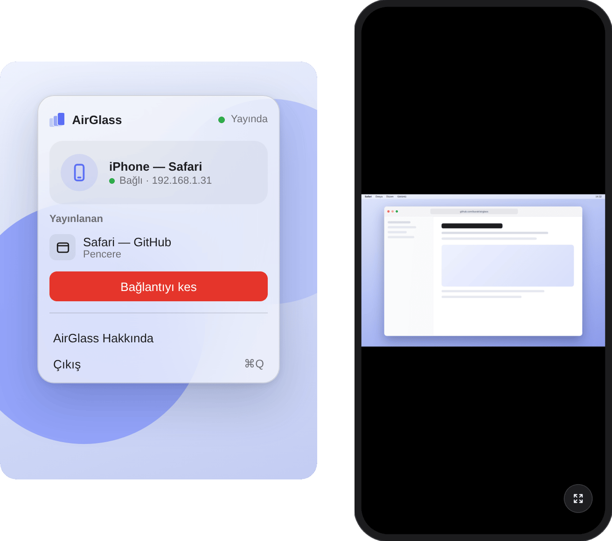
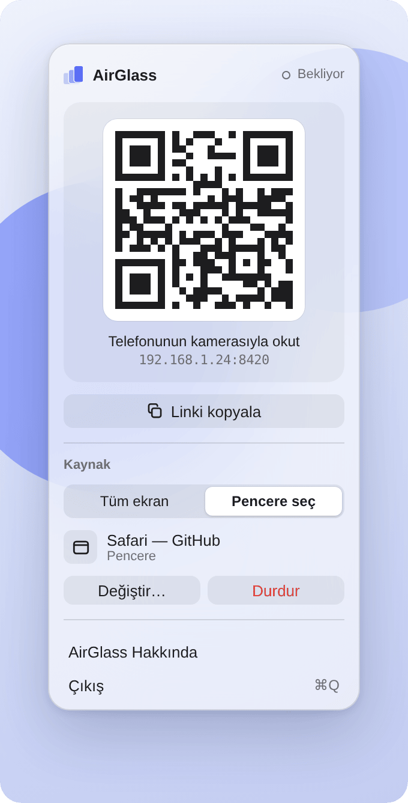
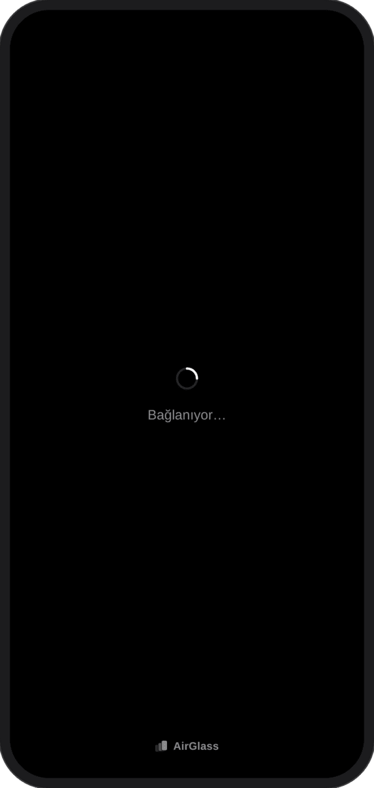
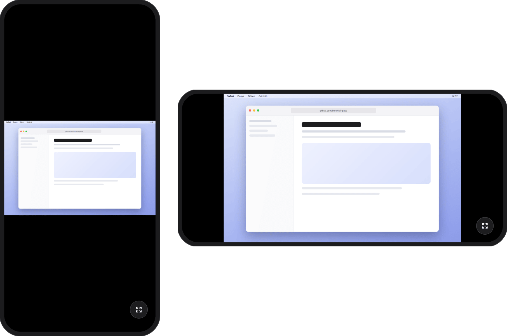
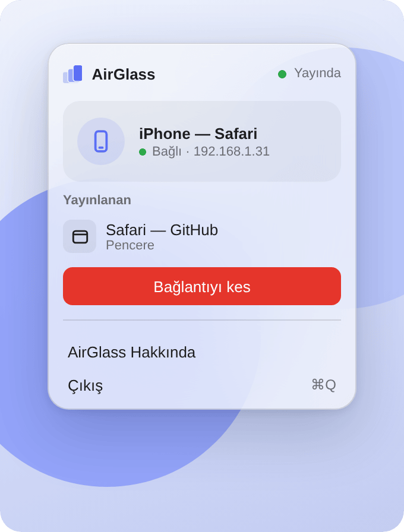
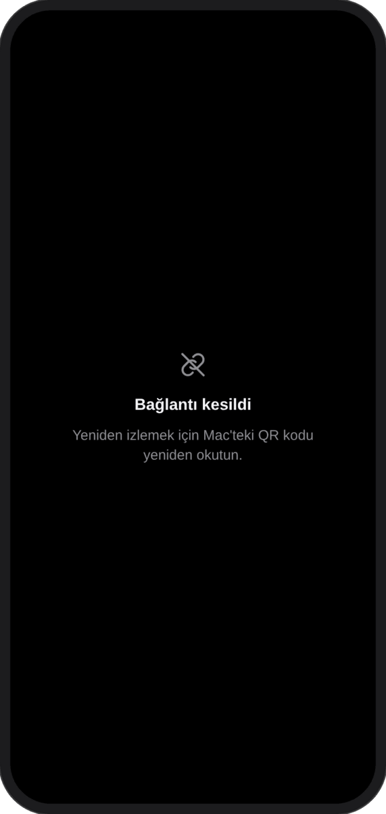

<p align="center">
  <picture>
    <source media="(prefers-color-scheme: dark)" srcset="Branding/wordmark-dark.svg">
    
  </picture>
</p>

<p align="center">
  <picture>
    <source media="(prefers-color-scheme: dark)" srcset="docs/screenshots/hero-dark.png">
    
  </picture>
</p>

<p align="center">
  <b>Türkçe</b> · <a href="#english">English</a>
</p>

---

## Türkçe

AirGlass, bilgisayarının ekranını ya da tek bir pencereyi aynı Wi-Fi'deki bir iPhone'un tarayıcısına canlı yansıtan, açık kaynak ve minimal bir uygulamadır. Telefona hiçbir şey kurmazsın: QR kodu okutursun, görüntü Safari'de açılır.

**Platformlar:** macOS 14 ve üstü (menü çubuğu uygulaması) ve Windows 10 (2004) / Windows 11 (sistem tepsisi uygulaması). İkisi aynı tasarımı, aynı izleme sayfasını ve aynı güvenlik kurallarını kullanır.

### Özellikler

- **Tamamen yerel.** Görüntü bilgisayarınızdan telefonunuza doğrudan, yerel ağ üzerinden gider. Uygulama internete hiçbir istek atmaz: analitik yok, güncelleme kontrolü yok, STUN/TURN sunucusu yok.
- **Şifreli görüntü.** Yayın WebRTC (DTLS-SRTP) ile şifrelenir. Video codec'i H.264'tür; telefonunuzda donanımla çözülür.
- **Uygulama kurmadan izleme.** Telefonunuzda yalnızca Safari (ya da başka bir tarayıcı) yeterli.
- **Tek kullanımlık QR.** QR kodun içindeki anahtar ilk bağlantıda geçersiz olur. Bağlantı kopunca ya da "Bağlantıyı kes"e basınca yeni bir QR üretilir.
- **Tek izleyici.** Biri izlerken başka bir cihaz bağlanamaz.
- **Sadece görüntü.** Telefonunuzdan bilgisayarınıza dokunma, fare ya da klavye girdisi gitmez.
- **Tüm ekran veya tek pencere.** Pencere (macOS'ta ekran da) işletim sisteminizin kendi içerik seçicisiyle seçilir.
- **Her an görünür.** Biri izlerken menü çubuğu veya sistem tepsisindeki ikon değişir.

### Kurulum

#### macOS

1. [Releases](https://github.com/lupusoftco/airglass/releases/latest) sayfasından `AirGlass-<sürüm>.dmg` dosyasını indir.
2. `.dmg`'yi aç ve **AirGlass**'ı **Applications** klasörüne sürükle.
3. AirGlass'ı aç. Uygulama Apple tarafından onaylanmadığı (notarize edilmediği) için macOS ilk açılışta engeller. Şöyle açabilirsin:
   1. Uyarıda **Bitti**'ye bas.
   2. **Sistem Ayarları → Gizlilik ve Güvenlik**'i aç.
   3. Aşağı kaydır. **Güvenlik** bölümünde AirGlass'ın engellendiğini söyleyen satırın yanındaki **Yine de Aç**'a bas.
   4. Parolanı gir ve çıkan pencerede yine **Yine de Aç**'ı seç.

   Bunu yalnızca bir kez yaparsın.

   **Alternatif:** Terminal'de uygulamanın karantina işaretini kaldırırsan macOS onu engellemez:

   ```sh
   xattr -dr com.apple.quarantine /Applications/AirGlass.app
   ```
4. Menü çubuğunda AirGlass ikonu belirir; Dock'ta ikon yoktur.
5. İlk kez bir kaynak seçtiğinde macOS **Ekran Kaydı** izni ister. **Sistem Ayarları → Gizlilik ve Güvenlik → Ekran ve Sistem Sesi Kaydı** bölümünden AirGlass'a izin ver, sonra AirGlass'ı kapatıp yeniden aç.
6. macOS **yerel ağ** erişimi ve güvenlik duvarı açıksa **gelen bağlantılar** için izin isteyebilir. İkisine de izin ver; telefon Mac'e bunlar sayesinde ulaşır.

#### Windows

1. [Releases](https://github.com/lupusoftco/airglass/releases/latest) sayfasından `AirGlass-<sürüm>.exe` dosyasını indir. Kurulum yok; tek dosyadır, .NET gerektirmez.
2. Çalıştır. Uygulama imzalı olmadığı için Windows SmartScreen "Windows bilgisayarınızı korudu" diyebilir: **Ek bilgi**'ye, sonra **Yine de çalıştır**'a bas. Bunu yalnızca bir kez yaparsın.
3. AirGlass ikonu görev çubuğunun sağındaki sistem tepsisinde belirir (görünmüyorsa **^** okunun altındadır). İkona tıklayınca popover açılır; sağ tıkta **AirGlass Hakkında** ve **Çıkış** vardır.
4. İlk açılışta **Windows Defender Güvenlik Duvarı** AirGlass için izin ister. **Özel ağlar** işaretliyken **Erişime izin ver**'e bas; telefon bilgisayara bu sayede ulaşır. Wi-Fi ağın Windows'ta **Ortak** olarak ayarlıysa ya ağı **Özel** yap (**Ayarlar → Ağ ve İnternet → Wi-Fi → ağın özellikleri**) ya da izin penceresinde **Ortak ağlar**'ı da işaretle.

### Nasıl çalışır

**1. Kaynağı seç ve QR kodu okut.** AirGlass'ı açın. **Tüm ekran** ya da **Pencere seç** ile neyin yansıtılacağını seçin, sonra QR kodu telefonunuzun kamerasıyla okutup açılan bağlantıya dokunun.

<p align="center">
  <picture>
    <source media="(prefers-color-scheme: dark)" srcset="docs/screenshots/popover-waiting-dark.png">
    
  </picture>
</p>

**2. Telefonunuz bağlanır.** Safari açılır ve bilgisayarınıza bağlanır; telefonunuza hiçbir şey kurulmaz.

<p align="center">
  
</p>

**3. Ekran telefonunuzda.** Görüntü yerel ağ üzerinden, şifreli olarak gelir. Görüntüye dokununca tam ekrana geçer; telefonunuzu yan da çevirebilirsiniz.

<p align="center">
  
</p>

**4. Bitirmek için Bağlantıyı kes.** Biri izlerken uygulama bağlı cihazı gösterir ve ikon değişir.

<p align="center">
  <picture>
    <source media="(prefers-color-scheme: dark)" srcset="docs/screenshots/popover-connected-dark.png">
    
  </picture>
</p>

**5. Yeni QR.** Telefon "Bağlantı kesildi" der. QR kod tek kullanımlık olduğu için bilgisayarda hemen yeni bir QR kod belirir.

<p align="center">
  
</p>

<sub>Görseller AirGlass'ın arayüz tasarımından üretilmiştir. Windows'ta popover sistem tepsisindeki ikonun üstünde açılır; içeriği aynıdır.</sub>

### Kaynaktan derleme

#### macOS

Gerekenler: macOS 14 (Sonoma) veya üstü, Xcode 16 veya üstü, [Homebrew](https://brew.sh).

```sh
brew install xcodegen
git clone https://github.com/lupusoftco/airglass.git
cd airglass
cp Config/Local.xcconfig.example Config/Local.xcconfig
```

`Config/Local.xcconfig` dosyasında `DEVELOPMENT_TEAM` satırına kendi Team ID'ni yaz. Ücretsiz "Personal Team" yeterli; Team ID'yi **Xcode → Settings → Accounts** bölümünde bulursun. Bu dosya git'e girmez. Team ID vermezsen uygulama ad-hoc imzalanır; çalışır ama macOS her derlemede Ekran Kaydı iznini yeniden ister.

```sh
make run    # projeyi üretir, derler ve AirGlass'ı başlatır
make dmg    # dist/AirGlass-<sürüm>.dmg üretir
make clean  # derleme çıktılarını siler
```

Xcode'da çalışmak istersen `make project` ile `AirGlass.xcodeproj` dosyasını üretip açabilirsin.

#### Windows

Gerekenler: Windows 10 (2004) veya üstü, [.NET 8 SDK](https://dotnet.microsoft.com/download/dotnet/8.0); exe üretmek için ayrıca [PowerShell 7](https://learn.microsoft.com/powershell/scripting/install/installing-powershell-on-windows) (`pwsh`).

```powershell
git clone https://github.com/lupusoftco/airglass.git
cd airglass
dotnet run --project Windows/AirGlass        # derler ve AirGlass'ı başlatır
pwsh scripts/windows-publish.ps1             # dist/AirGlass-<sürüm>.exe üretir ve test eder
```

`windows-publish.ps1` exe'yi üretip kısa bir süre çalıştırarak test eder; bu sırada açık bir AirGlass varsa önce kapat. Windows uygulaması `Windows/AirGlass` klasöründedir (WPF, C#). Telefondaki izleme sayfası iki uygulamada ortaktır: `Viewer/` klasöründeki dosyalar exe'nin içine gömülür.

### Bilinen sınırlamalar

- **Bilgisayar ve telefon aynı Wi-Fi'de olmalı.** Bağlantı yalnızca yerel ağda kurulur.
- **Misafir ya da istemci izolasyonlu ağlarda çalışmaz.** Otel, kafe, kurumsal misafir ağları gibi cihazların birbirini görmesine izin vermeyen ağlarda telefon bilgisayara ulaşamaz.
- **Ekranı açık tutma yöntemi çalan müziği durdurabilir.** Safari, http üzerinden açılan sayfalarda ekranı açık tutma API'sini (Wake Lock) sunmaz. AirGlass bunun yerine ilk dokunuşta görünmez, sessiz bir video oynatır. Bu da telefonda çalan müziği ya da podcast'i durdurabilir. Tam ekrandayken buna gerek kalmaz.
- **Ses aktarılmaz;** yalnızca görüntü.
- **Aynı anda tek izleyici.**
- **Sayfa ve sinyalleşme yerel ağda şifresiz HTTP üzerinden gider;** görüntünün kendisi şifrelidir. Tek kullanımlık anahtar URL'nin `#` kısmında taşınır, sunucu loglarına ve HTTP isteklerine girmez.
- **Uygulama notarize edilmemiş (macOS) ve imzalanmamıştır (Windows);** ilk açılışta macOS'ta "Yine de Aç", Windows'ta SmartScreen'de "Yine de çalıştır" adımı gerekir.
- **Windows'ta Pencere seç** ve birden fazla monitörde **Tüm ekran**, Windows'un kendi yakalama seçicisini açar; Windows 10'da yakalanan alanın çevresinde sarı bir çerçeve görünür.

### Lisans

[MIT](LICENSE)

---

<a id="english"></a>

## English

AirGlass is a small, open-source app that mirrors your computer's screen, or a single window, live to the browser of a phone on the same Wi-Fi. Nothing gets installed on the phone: scan the QR code and the picture opens in Safari.

**Platforms:** macOS 14 or later (menu bar app) and Windows 10 (2004) / Windows 11 (notification area app). Both share the same design, the same viewer page and the same security rules.

### Features

- **Entirely local.** Video goes straight from your computer to your phone over your local network. The app makes no requests to the internet: no analytics, no update checks, no STUN/TURN servers.
- **Encrypted video.** The stream uses WebRTC (DTLS-SRTP). The video codec is H.264, which your phone decodes in hardware.
- **Watch without an app.** Safari (or any modern browser) on your phone is all you need.
- **One-time QR code.** The key inside the QR code stops working after the first connection. A new QR code appears when the viewer disconnects or you press disconnect.
- **One viewer at a time.** While someone is watching, no other device can connect.
- **View only.** No touch, mouse or keyboard input goes from your phone to your computer.
- **Whole screen or a single window.** The window (on macOS, the screen too) is chosen with your operating system's own content picker.
- **Always visible.** The icon changes while someone is watching.

### Installation

#### macOS

1. Download `AirGlass-<version>.dmg` from the [Releases](https://github.com/lupusoftco/airglass/releases/latest) page.
2. Open the `.dmg` and drag **AirGlass** into **Applications**.
3. Open AirGlass. The app is not notarized by Apple, so macOS blocks the first launch. To open it:
   1. Click **Done** in the warning.
   2. Open **System Settings → Privacy & Security**.
   3. Scroll down to **Security** and click **Open Anyway** next to the line saying AirGlass was blocked.
   4. Enter your password and choose **Open Anyway** again.

   You only need to do this once.

   **Alternatively,** remove the quarantine flag in Terminal and macOS won't block the app:

   ```sh
   xattr -dr com.apple.quarantine /Applications/AirGlass.app
   ```
4. The AirGlass icon appears in the menu bar; there is no Dock icon.
5. The first time you pick a source, macOS asks for **Screen Recording** permission. Allow AirGlass under **System Settings → Privacy & Security → Screen & System Audio Recording**, then quit and reopen AirGlass.
6. macOS may also ask for **local network** access and, if the firewall is on, for **incoming connections**. Allow both; they are how the phone reaches the Mac.

#### Windows

1. Download `AirGlass-<version>.exe` from the [Releases](https://github.com/lupusoftco/airglass/releases/latest) page. There is no installer; it is a single file and needs no .NET installation.
2. Run it. The app is not signed, so Windows SmartScreen may say "Windows protected your PC": click **More info**, then **Run anyway**. You only need to do this once.
3. The AirGlass icon appears in the notification area at the right of the taskbar (if you don't see it, it is under the **^** arrow). Click it to open the popover; right-click for **AirGlass Hakkında** (About) and **Çıkış** (Quit).
4. On first launch **Windows Defender Firewall** asks about AirGlass. Keep **Private networks** checked and click **Allow access**; this is how the phone reaches the PC. If your Wi-Fi is set to **Public** in Windows, either make it **Private** (**Settings → Network & internet → Wi-Fi → your network's properties**) or also check **Public networks** in that dialog.

### How it works

**1. Pick a source and scan the QR code.** Click the AirGlass icon in the menu bar (on Windows, in the notification area). Choose **Tüm ekran** (whole screen) or **Pencere seç** (pick a window), then scan the QR code with your phone's camera and tap the link.

<p align="center">
  <picture>
    <source media="(prefers-color-scheme: dark)" srcset="docs/screenshots/popover-waiting-dark.png">
    
  </picture>
</p>

**2. The phone connects.** Safari opens and connects to your computer; nothing is installed on the phone.

<p align="center">
  
</p>

**3. Your screen, on the phone.** The picture arrives encrypted over your local network. Tap it to go fullscreen; rotating the phone works too.

<p align="center">
  
</p>

**4. Press Bağlantıyı kes (Disconnect) to stop.** While someone is watching, the popover shows the connected device and the menu bar icon changes.

<p align="center">
  <picture>
    <source media="(prefers-color-scheme: dark)" srcset="docs/screenshots/popover-connected-dark.png">
    
  </picture>
</p>

**5. A new QR code.** The phone shows "Bağlantı kesildi" (Disconnected). The QR code works only once, so the computer shows a fresh one right away.

<p align="center">
  
</p>

<sub>Images are rendered from AirGlass's interface design. On Windows the popover opens above the notification area icon, with the same content.</sub>

### Building from source

#### macOS

Requirements: macOS 14 (Sonoma) or later, Xcode 16 or later, [Homebrew](https://brew.sh).

```sh
brew install xcodegen
git clone https://github.com/lupusoftco/airglass.git
cd airglass
cp Config/Local.xcconfig.example Config/Local.xcconfig
```

Put your own Team ID in the `DEVELOPMENT_TEAM` line of `Config/Local.xcconfig`. The free "Personal Team" is enough; you can find the Team ID under **Xcode → Settings → Accounts**. This file is not committed. Without a Team ID the app is ad-hoc signed; it still runs, but macOS asks for Screen Recording permission again after every build.

```sh
make run    # generates the project, builds and launches AirGlass
make dmg    # creates dist/AirGlass-<version>.dmg
make clean  # removes build output
```

To work in Xcode, run `make project` and open the generated `AirGlass.xcodeproj`.

#### Windows

Requirements: Windows 10 (2004) or later, [.NET 8 SDK](https://dotnet.microsoft.com/download/dotnet/8.0); to build the exe, also [PowerShell 7](https://learn.microsoft.com/powershell/scripting/install/installing-powershell-on-windows) (`pwsh`).

```powershell
git clone https://github.com/lupusoftco/airglass.git
cd airglass
dotnet run --project Windows/AirGlass        # builds and launches AirGlass
pwsh scripts/windows-publish.ps1             # creates and tests dist/AirGlass-<version>.exe
```

`windows-publish.ps1` builds the exe and tests it by running it briefly, so quit any running AirGlass first. The Windows app lives in `Windows/AirGlass` (WPF, C#). The viewer page on the phone is shared by both apps: the files in `Viewer/` are embedded in the exe.

### Known limitations

- **The computer and the phone must be on the same Wi-Fi.** Connections only work on the local network.
- **Guest networks and networks with client isolation don't work.** Hotel, café and corporate guest networks that stop devices from seeing each other keep the phone from reaching the computer.
- **Keeping the screen awake may pause music.** Safari does not offer the Wake Lock API on pages served over http, so AirGlass plays an invisible, silent video after the first tap. That can pause music or podcasts playing on the phone. It isn't needed in fullscreen.
- **No audio;** video only.
- **One viewer at a time.**
- **The page and the signaling travel over unencrypted HTTP on the local network;** the video itself is encrypted. The one-time key travels in the URL fragment (`#`), so it never appears in server logs or HTTP requests.
- **The app is not notarized (macOS) or signed (Windows),** so the first launch needs the "Open Anyway" step on macOS and "Run anyway" in SmartScreen on Windows.
- **On Windows, Pencere seç** (pick a window), and **Tüm ekran** (whole screen) with more than one monitor, open Windows' own capture picker; on Windows 10 a yellow border marks what is being captured.

### License

[MIT](LICENSE)
